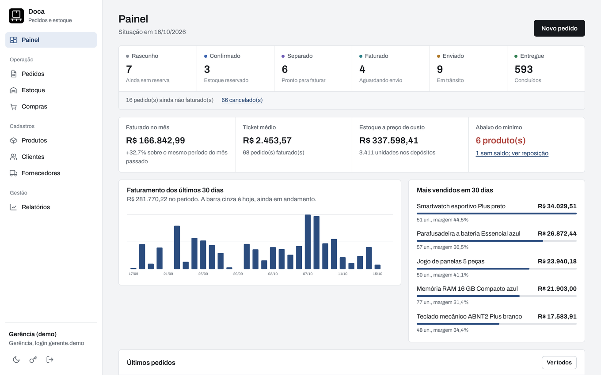
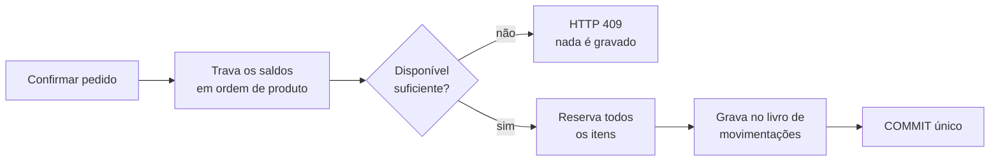
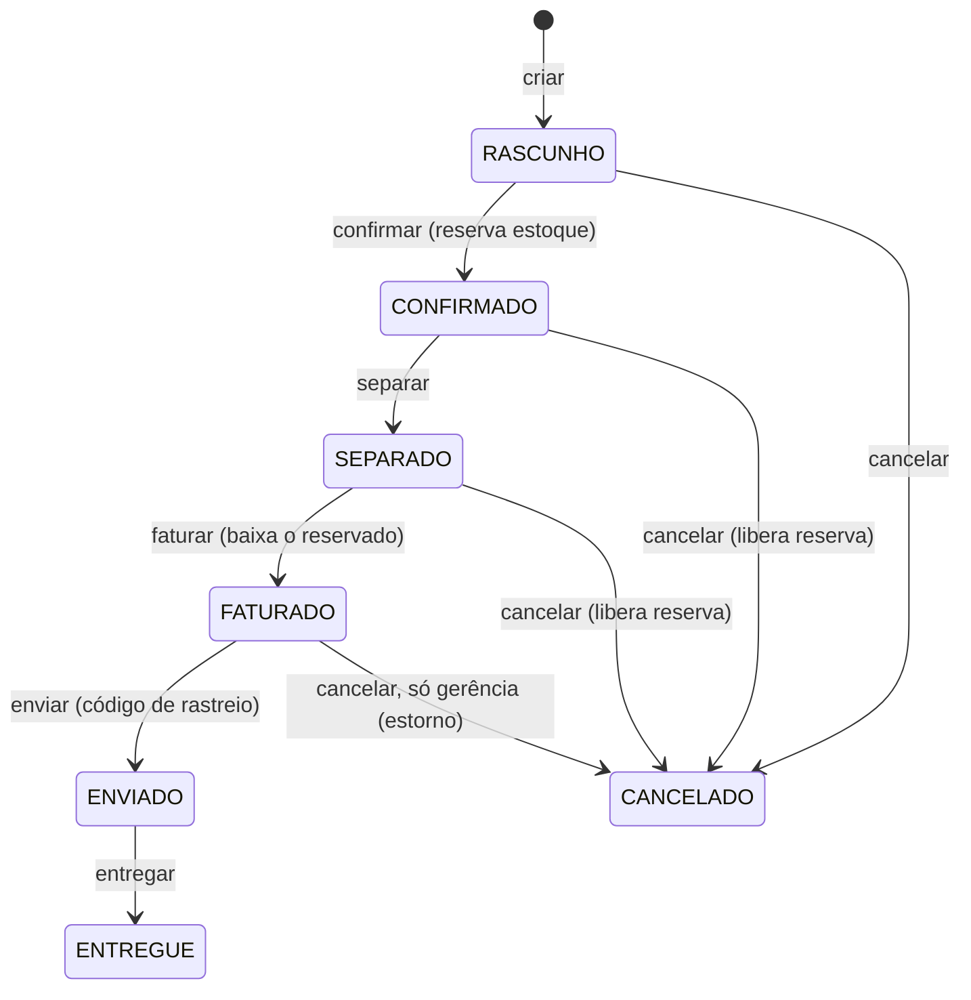
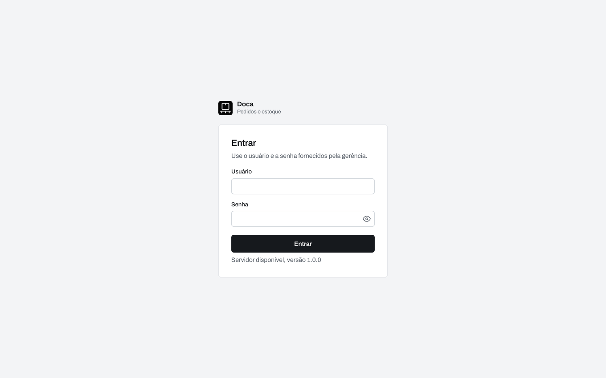
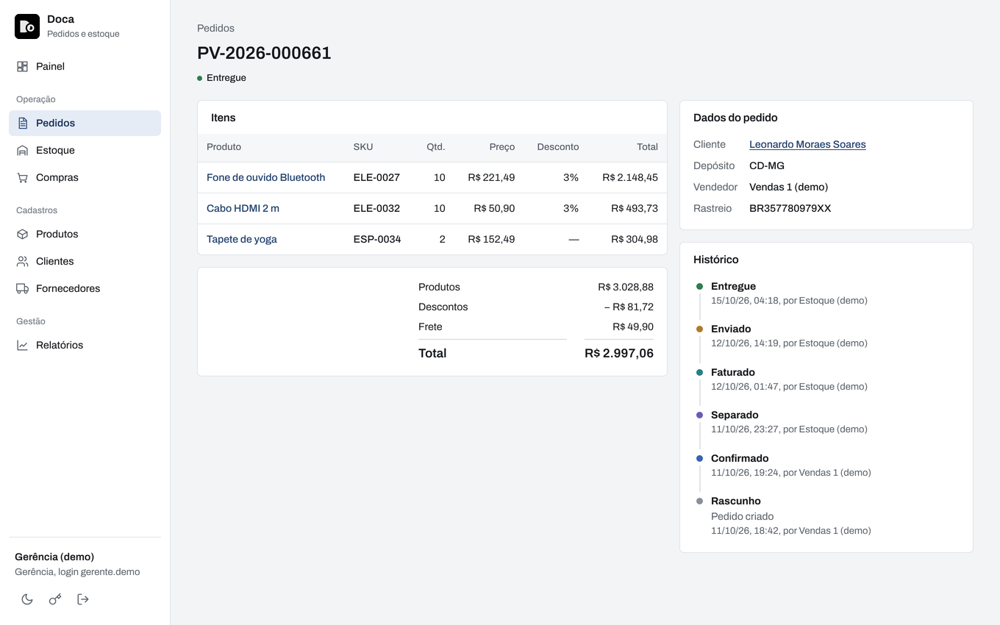
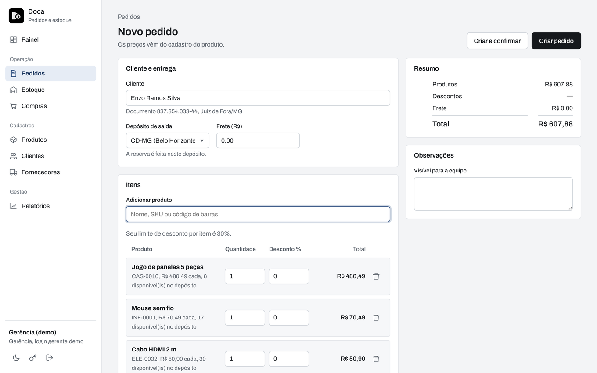
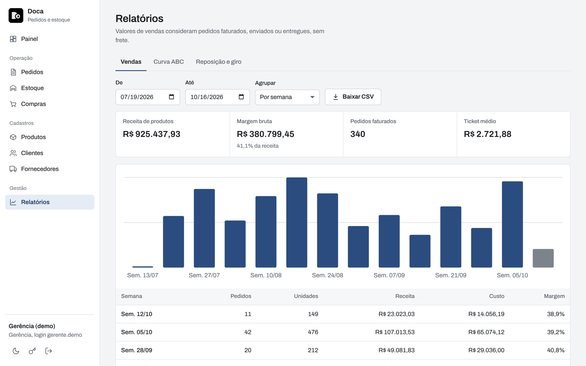
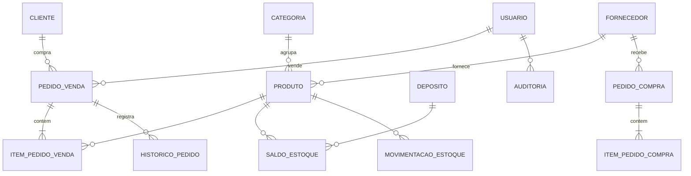

<p align="center">
  
</p>

<h1 align="center">Doca<br><sub><sup><sup><sub>Copyright (©) 2026 Erik Pimenta</sub></sup></sup></sub></h1>

<p align="center">
  Sistema de pedidos de venda, compras e controle de estoque multi-depósito, com API REST e painel web com login.<br>
  O estoque é reservado no momento da confirmação, e nenhum pedido vende acima do saldo disponível, mesmo com acessos simultâneos.
</p>

<p align="center">
  Python 3.12+ · FastAPI · SQLAlchemy 2 · PostgreSQL 17 ou SQLite · Alembic · Pydantic v2 · JWT · HTML, CSS e JS puros · Docker · GitHub Actions
</p>

---

> **Manual completo:** [`Manual-Doca.pdf`](Manual-Doca.pdf) explica instalação, configuração, perfis, todas as telas, regras de pedidos e estoque, arquitetura, API, banco de dados e solução de problemas, passo a passo (cópia em [`docs/`](docs/Manual-Doca.pdf)).

> **Dados fictícios:** todos os clientes, fornecedores e produtos são gerados por script. Veja [Dados fictícios](#dados-fictícios).

<p align="center">
  
</p>

## O que o Doca faz

- **Pedidos de venda** com rascunho editável, confirmação com reserva de estoque, separação, faturamento, envio com rastreio, entrega e cancelamento com liberação de reserva ou estorno.
- **Estoque por depósito** com saldo físico, reservado e disponível, entradas, ajuste por contagem, transferências e um livro de movimentações imutável.
- **Compras** ao fornecedor com recebimento total ou parcial e recálculo do custo médio ponderado.
- **Cadastros** de produtos (SKU, EAN-13, categoria, preço, estoque mínimo), clientes PF/PJ com validação de CPF/CNPJ, fornecedores e depósitos.
- **Relatórios** de vendas por dia, semana, mês, categoria, produto, vendedor, cliente ou UF, curva ABC, giro, cobertura em dias e sugestão de compra, com exportação em CSV.
- **Quatro perfis de acesso**, senha provisória com troca obrigatória e trilha de auditoria.
- **Tema claro e escuro**, layout responsivo para celular.

## Interface

Visual sóbrio, pensado para operação diária e tabelas densas:

- Fundo cinza-claro, painéis brancos e bordas finas. O azul-marinho `#2B4C7E` é o único destaque: item ativo do menu, barras dos gráficos, abas e foco do teclado.
- Fonte Archivo em largura normal, incluída no projeto (sem CDN), com números tabulares nas tabelas.
- Pedidos por etapa numa faixa única com a contagem de cada status. As seis cores de situação ficam só nos marcadores, para diferenciar as etapas num relance.
- Cantos de 4 a 6 px, filtros em botões retangulares e cabeçalhos de tabela em cinza suave.
- Tema escuro com a mesma estrutura e contraste ajustado.

| Cor | Uso |
|---|---|
| `#F3F4F6` | Fundo das páginas |
| `#FFFFFF` | Painéis, tabelas e formulários |
| `#E1E4E8` | Bordas e divisórias |
| `#5B626B` | Textos de apoio |
| `#16191D` | Texto e botões principais |
| `#2B4C7E` | Destaque, gráficos e foco |

## Como o Doca evita venda dupla



1. **Reserva atômica:** todos os itens são reservados ou nenhum. As linhas de saldo são travadas com `SELECT … FOR UPDATE`, sempre na mesma ordem, o que evita *deadlock*.
2. **Disponível = físico − reservado.** O banco garante por `CHECK` que nenhum saldo fica negativo e que a reserva nunca passa do físico.
3. **Idempotência:** `POST /pedidos` aceita o cabeçalho `Idempotency-Key`. Repetir a requisição devolve o mesmo pedido em vez de duplicar.
4. **Controle otimista de versão** em produtos e pedidos: duas pessoas editando o mesmo registro não sobrescrevem uma à outra (HTTP 409).
5. **Teste de concorrência:** `tests/test_concorrencia.py` dispara 20 confirmações simultâneas para 5 unidades e exige exatamente 5 sucessos.

### Ciclo do pedido



Outras regras: desconto máximo por perfil (vendas 10%, gerência 30%), limite de crédito do cliente liberável pela gerência e custo congelado no item do pedido para a margem histórica não mudar.

## Como rodar

Pré-requisito: **Python 3.12 ou mais recente**.

**Windows:** dê dois cliques em `iniciar.bat`.
**Linux / macOS:** `./iniciar.sh`

Os scripts copiam `.env.example` para `.env`, criam o ambiente virtual, instalam as dependências, geram seis meses de operação fictícia e abrem o navegador em **http://127.0.0.1:8000**.

Manualmente:

```bash
python -m venv .venv
.venv\Scripts\activate            # Windows
source .venv/bin/activate         # Linux / macOS
pip install -r requirements-dev.txt
copy .env.example .env            # Windows  (cp no Linux / macOS)
python -m scripts.popular_banco   # dados fictícios (use --limpar para recomeçar)
uvicorn app.main:app --reload --host 127.0.0.1
```

### Com Docker (PostgreSQL + API)

Preencha no `.env` as variáveis `CHAVE_SECRETA`, `POSTGRES_BANCO`, `POSTGRES_USUARIO` e `POSTGRES_SENHA` e rode:

```bash
docker compose up -d --build
docker compose logs api        # mostra as credenciais de demonstração
```

Se faltar alguma variável obrigatória, o Docker para e avisa qual. As portas ficam presas a `127.0.0.1`.

## Login

| Usuário | Perfil |
|---|---|
| `admin` | Administração |
| `gerente.demo` | Gerência |
| `vendas1.demo` · `vendas2.demo` · `vendas3.demo` | Vendas |
| `estoque.demo` | Estoque |

O repositório não traz senhas. Na primeira execução elas são geradas e gravadas em `dados/credenciais_demo.txt` e `dados/senha_inicial_admin.txt`, que ficam só no seu computador. Para escolher as suas, preencha `ADMIN_SENHA` e `SENHA_DEMO` no `.env`.

| Tela | |
|---|---|
|  |  |
|  |  |

### O que cada perfil pode fazer

| Ação | Administração | Gerência | Vendas | Estoque |
|---|:-:|:-:|:-:|:-:|
| Criar, editar e confirmar pedidos | ✓ | ✓ | ✓ (os seus) | |
| Separar, faturar, enviar, entregar | ✓ | ✓ | | ✓ |
| Cancelar pedido faturado (estorno) | ✓ | ✓ | | |
| Entrada, ajuste e transferência de estoque | ✓ | ✓ | | ✓ |
| Criar compras / receber mercadoria | ✓ / ✓ | ✓ / ✓ | | — / ✓ |
| Cadastrar produtos e preços | ✓ | ✓ | | |
| Relatórios de vendas e curva ABC | ✓ | ✓ | | |
| Ver CPF completo do cliente | ✓ | ✓ | revelar (auditado) | |
| Usuários e auditoria | ✓ | | | |

## Configuração

Todas as opções ficam no `.env` (modelo em [`.env.example`](.env.example)), que nunca vai para o Git.

| Variável | Padrão | Função |
|---|---|---|
| `CHAVE_SECRETA` | gerada em `dados/` | Assinatura dos tokens. Obrigatória no Docker e em produção |
| `ADMIN_USUARIO` / `ADMIN_SENHA` | `admin` / aleatória | Primeiro administrador |
| `SENHA_DEMO` | aleatória | Senha dos usuários de demonstração |
| `DATABASE_URL` | SQLite em `dados/` | Outro banco, por exemplo `postgresql://<usuario>:<senha>@<servidor>:5432/<banco>` |
| `POSTGRES_BANCO` / `POSTGRES_USUARIO` / `POSTGRES_SENHA` | — | Banco criado pelo Docker |
| `PORTA_API` / `PORTA_BANCO` | `8000` / `5432` | Portas no seu computador |
| `COOKIE_SEGURO` | `false` | `true` quando o sistema estiver atrás de HTTPS |

Para gerar uma `CHAVE_SECRETA`:

```bash
python -c "import secrets; print(secrets.token_urlsafe(48))"
```

## Banco de dados

As migrações ficam em `alembic/versions/` e o Docker as aplica antes de subir a API. Dinheiro é gravado como inteiro de centavos (sem erro de ponto flutuante) e datas em UTC, com relatórios agrupados no fuso `America/Sao_Paulo`.



| Tabela | O que guarda |
|---|---|
| `saldo_estoque` | Quantidade física e reservada de cada produto em cada depósito |
| `movimentacao_estoque` | Livro imutável de tudo que alterou um saldo |
| `pedido_venda` · `item_pedido_venda` · `historico_pedido` | Pedidos, itens com preço e custo congelados, e cada mudança de status |
| `pedido_compra` · `item_pedido_compra` | Compras e quanto de cada item já foi recebido |
| `usuario` · `auditoria` | Acesso por perfil e trilha de quem fez o quê |

Para mudar o banco:

```bash
alembic revision --autogenerate -m "descreva a mudança"
alembic upgrade head
alembic check   # falha se os modelos e as migrações divergirem
```

## Estrutura

```
app/
  main.py            criação do app, middlewares, rotas e arquivos estáticos
  config.py          configuração lida do .env
  database.py        engine, sessão e tipos (dinheiro exato, data/hora UTC)
  seguranca.py       scrypt, JWT e limitador de login
  middleware.py      cabeçalhos de segurança, CSRF e limite de requisições
  modelos/           tabelas SQLAlchemy e enums
  esquemas/          contratos de entrada e saída (Pydantic)
  servicos/          regras de negócio: estoque, pedidos, compras, relatórios, auditoria
  rotas/             endpoints da API
web/                 painel (HTML, CSS, JS, fonte e ícone)
alembic/             migrações do banco
scripts/             gerador de dados fictícios e relatório diário
tests/               80 testes (unidade, API e concorrência)
docs/                capturas de tela, logo, guia de publicação e relatório diário
```

## API

Documentação interativa em **http://127.0.0.1:8000/docs** (Swagger) e `/redoc`. O painel usa cookie `HttpOnly`; scripts e integrações usam `Authorization: Bearer <token>`.

| Método | Rota (prefixo `/api/v1`) | Função |
|---|---|---|
| POST | `/auth/login` · `/auth/logout` · `/auth/trocar-senha` | Entrar, sair e trocar senha |
| GET / POST | `/pedidos` | Listar e criar pedidos |
| GET / PATCH | `/pedidos/{id}` | Ver e editar um pedido |
| POST | `/pedidos/{id}/confirmar · separar · faturar · enviar · entregar · cancelar` | Avançar o pedido |
| GET | `/estoque/saldos` · `/estoque/movimentacoes` | Saldos e histórico |
| POST | `/estoque/entradas · ajustes · transferencias` | Movimentar estoque |
| GET / POST | `/compras` | Listar e criar compras |
| POST | `/compras/{id}/enviar · receber · cancelar` | Avançar a compra |
| GET / POST | `/produtos` · `/clientes` · `/fornecedores` · `/depositos` · `/usuarios` | Cadastros |
| GET | `/relatorios/dashboard · vendas · curva-abc · giro-estoque` | Relatórios (aceitam `formato=csv`) |

Erros seguem sempre o mesmo formato:

```json
{ "erro": { "codigo": "estoque_insuficiente", "mensagem": "Estoque disponível insuficiente para confirmar o pedido.",
            "detalhes": [{ "sku": "INF-0003", "disponivel": 4, "solicitado": 6 }] } }
```

## Segurança e privacidade

- Senhas com **scrypt** e sal individual, bloqueio após 5 tentativas erradas e limite de requisições por minuto.
- Sessão em **cookie HttpOnly + SameSite=Strict**, com proteção CSRF. Trocar senha, desativar usuário ou mudar o perfil encerra todas as sessões.
- CSP restritiva, `X-Frame-Options: DENY`, `nosniff`, `Referrer-Policy: no-referrer` e HSTS quando em HTTPS.
- **Nenhum endereço IP é gravado:** a auditoria guarda só um código HMAC irreversível da origem.
- **CPF mascarado** para perfis operacionais; revelar o documento fica registrado na auditoria (LGPD).
- A interface não carrega nada de fora (sem CDNs, Google Fonts ou analytics).
- **Exportações CSV sem injeção de fórmulas:** texto que começa com `=`, `+`, `-` ou `@` sai com um apóstrofo na frente, então um produto ou cliente chamado `=HIPERLINK(...)` abre no Excel e no LibreOffice como texto, e não como fórmula. Valores numéricos não mudam.

## Testes

```bash
pip install -r requirements-dev.txt
pytest                                  # SQLite em memória
TEST_DATABASE_URL=postgresql://<usuario>:<senha>@localhost:5432/<banco_de_teste> pytest   # inclui o teste de concorrência
ruff check . && ruff format --check .
```

A integração contínua ([`.github/workflows/ci.yml`](.github/workflows/ci.yml)) roda lint, a suíte completa em SQLite **e** em PostgreSQL, o ciclo de migrações, a geração dos dados de demonstração e o build da imagem Docker.

## Dados fictícios

O script `scripts/popular_banco.py` simula meses de operação passando pelas mesmas regras da API, então reservas, baixas e custos são coerentes entre si. Nomes são combinações aleatórias, CPFs e CNPJs só têm dígitos verificadores válidos, e-mails usam domínios reservados para exemplos (`example.com`) e códigos de barras usam o prefixo 2, de circulação restrita. Qualquer semelhança com pessoas ou empresas reais é coincidência.

Para publicar o seu próprio fork sem expor dados pessoais, siga o guia [`docs/c.md`](docs/c.md).

## Licença

[MIT](LICENSE). Use, copie, altere e distribua à vontade. A fonte Archivo é distribuída sob a [SIL Open Font License](web/fonts/OFL-Archivo.txt).
